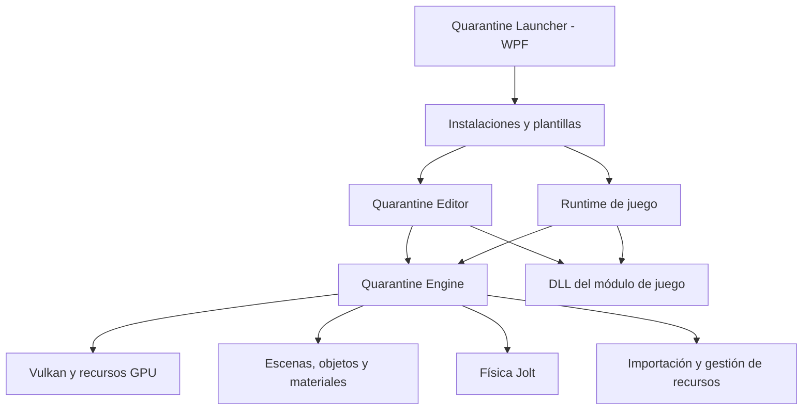
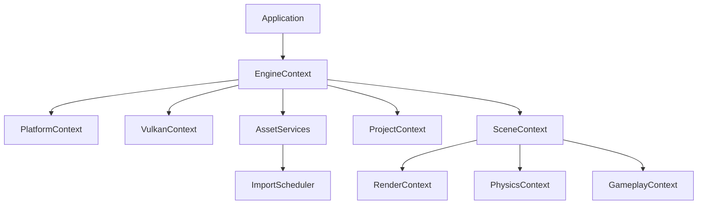
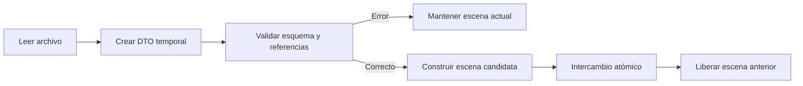

# Informe de estabilidad y evolución de Vulkan Quarantine Engine

> **Fecha del análisis:** 28 de agosto de 2026  
> **Rama analizada:** `main`  
> **Commit:** `a53b2b3`  
> **Objetivo:** recuperar el desarrollo sobre una base reproducible, estable y preparada para evolucionar.

## Estado de ejecución del plan

> **Última actualización:** 2 de noviembre de 2026  
> **Fase activa:** Fase 1 - Ciclo de vida seguro  
> **Estado:** Fase 0 validada en CI; criterio operativo de la Fase 1 validado localmente con 100 ciclos limpios. Sigue pendiente completar la migración estructural a un orden RAII único.

Resultados incorporados hasta esta iteración:

- Dependencias FetchContent centralizadas en [`cmake/Dependencies.cmake`](../cmake/Dependencies.cmake).
- `yaml-cpp` fijado a `yaml-cpp-0.9.0` y `stb` a un commit exacto; eliminadas las ramas móviles.
- Editor compilado correctamente en Debug y Release.
- Launcher Release compilado con .NET SDK 9.0.312, sin errores ni advertencias.
- Proyecto `QEExample` compilado correctamente en Debug y Release.
- Proyecto temporal creado por el launcher contra el paquete local, compilado en Debug y Release y eliminado después de la prueba.
- Corregidos los nombres Debug de Jolt (`Joltd.lib`) y KTX (`ktxd.lib`) en empaquetado y plantillas.
- Paquete local Debug + Release generado correctamente y ampliado con toolchain, dependencias y estado dirty.
- Añadido [workflow de validación](../.github/workflows/validate.yml) para builds, shaders, ejemplo y paquete.
- Workflows de publicación alineados con versiones fijas de .NET, CMake y Vulkan SDK.
- Primera ejecución de CI diagnosticada: `windows-latest` había migrado a Visual Studio 2026; los workflows C++ quedaron fijados a `windows-2022` y MSBuild 17.x.
- La validación de shaders comprueba ahora su compilación y rechaza cambios inesperados, sin exigir igualdad binaria entre SPIR-V producido por versiones distintas de `glslc`.
- La integración de Assimp incluye y empaqueta ahora sus headers generados por CMake (`config.h` y `revision.h`), eliminando otra dependencia de archivos residuales del workspace local.
- Los nombres de salida Debug del SDK se declaran explícitamente en CMake; Jolt y KTX mantienen nombres sin sufijo porque se separan por directorio de configuración.
- El workflow completo de validación ha finalizado correctamente en un runner limpio de GitHub Actions.
- Eliminados el self-delete de `DeviceModule` y el doble reset de `ShadowPipelineManager`.
- `QESingleton` admite ahora reset y recreación real, con acceso sincronizado y una prueba CTest en Debug y Release.
- El importador asíncrono bloquea nuevos trabajos durante el cierre, drena la cola y realiza `join` antes del teardown del editor.
- Los fallos booleanos de importación ya no se publican como trabajos completados correctamente.
- `QEBaseApp::Run` garantiza `OnShutdown` y cleanup ante excepciones de ejecución; `main` registra las excepciones no controladas y descarga el módulo de proyecto.
- El frame abandona inmediatamente la adquisición `OUT_OF_DATE`; fences y compute sólo avanzan cuando existe una imagen válida.
- Resize, minimizado y restauración tienen ahora una transición explícita, incluido el cierre mientras la ventana está minimizada.
- La recreación distingue cambios de extensión de cambios de compatibilidad: render passes, pipelines e ImGui sólo se reconstruyen cuando cambian formato o conteo de imágenes.
- La selección de GPU aplica un [perfil Vulkan estable documentado](VULKAN_COMPATIBILITY.md), registra motivos de rechazo y prioriza la mejor candidata compatible.
- Features y extensiones se consultan y habilitan de forma coherente; mesh shaders, buffer device address, sample shading, wireframe y líneas anchas son opcionales reales.
- Las extensiones promovidas a core ya no se exigen por nombre y el módulo experimental de ray tracing queda fuera del perfil estable.
- Editor y `QEExample` vuelven a compilar en Debug y Release después del cambio de perfil; el smoke local completa el arranque Vulkan y una salida limpia.

Pendiente de la estrategia de entrega:

- Acordar y normalizar la estrategia de versiones/tags sin reescribir el historial existente.

## Índice

1. [Resumen ejecutivo](#1-resumen-ejecutivo)
2. [Alcance y metodología](#2-alcance-y-metodología)
3. [Estado actual del proyecto](#3-estado-actual-del-proyecto)
4. [Arquitectura observada](#4-arquitectura-observada)
5. [Matriz de riesgos](#5-matriz-de-riesgos)
6. [Riesgos críticos y evidencias](#6-riesgos-críticos-y-evidencias)
7. [Riesgos estructurales y de diseño](#7-riesgos-estructurales-y-de-diseño)
8. [Persistencia y seguridad de los datos](#8-persistencia-y-seguridad-de-los-datos)
9. [Launcher, paquetes y distribución](#9-launcher-paquetes-y-distribución)
10. [Pruebas, CI y reproducibilidad](#10-pruebas-ci-y-reproducibilidad)
11. [Funcionalidades pendientes o parciales](#11-funcionalidades-pendientes-o-parciales)
12. [Fortalezas del proyecto](#12-fortalezas-del-proyecto)
13. [Arquitectura objetivo recomendada](#13-arquitectura-objetivo-recomendada)
14. [Hoja de ruta de estabilización](#14-hoja-de-ruta-de-estabilización)
15. [Definición de estabilidad](#15-definición-de-estabilidad)
16. [Backlog inicial recomendado](#16-backlog-inicial-recomendado)
17. [Conclusión](#17-conclusión)

---

## 1. Resumen ejecutivo

Vulkan Quarantine Engine tiene una base técnica amplia y valiosa: motor, editor, launcher, plantillas de proyecto, sistema de materiales y shaders, animación, física, importación de recursos y distribución de paquetes. No parece necesaria una reescritura completa.

Sin embargo, su estado actual debe tratarse como una **alfa técnica**. Antes de seguir incorporando funcionalidades, es necesario recuperar una línea base que cumpla cuatro propiedades:

1. Un clon limpio debe producir siempre la misma compilación.
2. El motor debe arrancar y apagarse de manera determinista.
3. Una escena inválida, un fallo de disco o una importación pendiente no deben corromper el proyecto ni derribar el editor.
4. Cada cambio debe validarse automáticamente antes de publicarse.

El hallazgo más inmediato es práctico: **el editor no compila actualmente usando el estado fresco de sus dependencias**. `yaml-cpp` y `stb` se descargan desde ramas móviles `master`. Una actualización reciente de `yaml-cpp` rompió la compatibilidad con las conversiones YAML del motor.

También existen defectos confirmados en:

- El orden y la duplicación de operaciones durante el apagado.
- La recreación del swapchain.
- La negociación de features y extensiones Vulkan.
- El cierre del importador asíncrono.
- La carga y escritura de escenas.
- La compatibilidad binaria del módulo de juego.
- La integridad y actualización de paquetes instalados por el launcher.

### Recomendación principal

Congelar temporalmente las nuevas funcionalidades y dedicar una fase específica a:

1. Recuperar la compilación reproducible.
2. Corregir el ciclo de vida del motor.
3. Proteger escenas y proyectos.
4. Incorporar pruebas y CI de validación.
5. Estabilizar los límites entre motor, editor, runtime y módulo de juego.

Solo después debería retomarse el desarrollo de la demo, UI de runtime, postprocesado o render avanzado.

---

## 2. Alcance y metodología

El análisis ha incluido:

- Aproximadamente 31.700 líneas C++ del motor.
- Aproximadamente 11.700 líneas C++ del editor.
- Aproximadamente 3.000 líneas C# del launcher.
- Configuración CMake y scripts de construcción.
- Shaders y artefactos SPIR-V.
- Plantillas de proyecto y runtime.
- Persistencia YAML de escenas y recursos.
- Ciclos de inicialización, ejecución y apagado.
- Integración de Vulkan, física e importación asíncrona.
- Empaquetado, instalación y workflows de GitHub Actions.
- Documentación, historial Git e issues públicas.

### Comprobaciones ejecutadas

| Comprobación | Resultado |
|---|---|
| Estado de Git | Limpio |
| Rama y commit | `main`, `a53b2b3` |
| Editor Debug | Falla durante la compilación por incompatibilidad con `yaml-cpp` |
| Launcher | Compila con 0 errores y 0 advertencias después de restaurar dependencias |
| Pruebas propias | No existen suites automatizadas del proyecto |
| Shaders | Las fuentes tienen SPIR-V correspondiente y no aparecen desactualizadas |
| Ejecución completa Vulkan | No realizada porque la compilación actual del editor está bloqueada |

Este informe diferencia entre:

- **Defecto confirmado:** comportamiento incorrecto demostrable en el código o compilación.
- **Riesgo de diseño:** arquitectura que facilita fallos o dificulta su verificación.
- **Trabajo pendiente:** capacidad mencionada o parcialmente implementada, pero todavía no completa.

---

## 3. Estado actual del proyecto

### Valoración por área

| Área | Estado | Observación principal |
|---|---|---|
| Motor y render | Inestable | Amplia funcionalidad, pero ciclo de vida y selección de features frágiles |
| Editor | Funcionalidad avanzada, base frágil | Muchas herramientas, sin protección suficiente ante fallo o pérdida de datos |
| Launcher | Base razonable | Compila, pero instalación y actualización necesitan validación transaccional |
| Runtime de juego | Parcial | Plantillas y carga de DLL presentes, con rutas y ABI frágiles |
| Persistencia | Alto riesgo | Sin versionado general, migraciones ni guardado atómico |
| Pruebas | Ausentes | No hay red de seguridad automatizada |
| CI | Orientada a publicación | Falta una puerta de calidad previa a integrar o publicar |
| Documentación | Útil, parcialmente desalineada | Algunas afirmaciones ya no reflejan el código actual |
| Multiplataforma | No disponible realmente | La implementación efectiva es Windows-only |

### Lectura global

El proyecto ha superado la fase de prototipo pequeño, pero sus mecanismos de estabilidad siguen siendo los de un prototipo. La cantidad de subsistemas y relaciones ha crecido más rápido que las garantías automáticas que los protegen.

---

## 4. Arquitectura observada

El repositorio contiene cuatro productos o capas principales:



La separación de carpetas es clara, pero dentro del motor las fronteras son menos explícitas. `QEBaseApp` obtiene y coordina numerosos singletons, y conoce el orden concreto en el que deben iniciarse y destruirse.

La escena tampoco es propietaria completa de sus datos. Gran parte del estado reside en managers globales, lo que dificulta:

- Mantener más de una escena en memoria.
- Construir una escena temporal para validarla.
- Ejecutar pruebas aisladas.
- Descargar o sustituir una escena de manera transaccional.
- Reiniciar el motor dentro del mismo proceso.

---

## 5. Matriz de riesgos

| ID | Riesgo | Probabilidad | Impacto | Prioridad |
|---|---|---:|---:|---:|
| R01 | Dependencias móviles rompen la compilación | Alta | Crítico | P0 |
| R02 | Doble destrucción o uso después de liberar durante el apagado | Alta | Crítico | P0 |
| R03 | Continuar un frame después de recrear el swapchain | Alta | Crítico | P0 |
| R04 | Solicitar features Vulkan no consultadas o no soportadas | Alta | Crítico | P0 |
| R05 | Worker de importación activo mientras se destruye el motor | Media/Alta | Crítico | P0 |
| R06 | Guardado directo puede truncar o corromper escenas | Media | Crítico | P0 |
| R07 | Carga de escena no transaccional deja estado parcial | Alta | Alto | P0 |
| R08 | ABI del módulo de juego incompatible entre versiones | Media | Crítico | P1 |
| R09 | Exceso de singletons y orden de inicialización implícito | Alta | Alto | P1 |
| R10 | Instalación de paquetes sin hash, staging ni rollback | Media | Alto | P1 |
| R11 | Ausencia de pruebas automáticas | Alta | Alto | P1 |
| R12 | Logging no persistente y ausencia de crash dump | Alta | Alto | P1 |
| R13 | Sin dirty state, autosave o recuperación | Media/Alta | Alto | P1 |
| R14 | Borrados inmediatos sin papelera o undo general | Media | Alto | P1 |
| R15 | Sincronización compute/gráficos insuficientemente expresada | Media | Alto | P1 |
| R16 | Rutas de runtime dependientes del working directory | Alta | Medio/Alto | P1 |
| R17 | Documentación desalineada con threading y features | Alta | Medio | P2 |
| R18 | Linux comunicado como objetivo sin una capa de plataforma | Alta | Medio | P2 |
| R19 | Hotspots muy grandes y responsabilidades mezcladas | Alta | Medio | P2 |
| R20 | Uso excesivo de esperas globales de GPU | Alta | Medio | P2 |

---

## 6. Riesgos críticos y evidencias

### 6.1. Compilación no reproducible

`stb` y `yaml-cpp` se obtienen desde `master` en [CMakeLists.txt](../CMakeLists.txt#L55).

La versión de `yaml-cpp` descargada actualmente modificó la declaración de `YAML::convert`. El motor mantiene una declaración anticipada incompatible en [Bone.h](../src/QuarantineEngine/Utilities/Animation/Bone.h#L11), además de varias especializaciones basadas en la firma anterior.

La compilación Debug del editor falla con errores C2976, C2990 y C2913. Esto demuestra que el commit del proyecto no contiene suficiente información para reconstruir sus binarios.

#### Acción requerida

- Fijar `yaml-cpp` y `stb` a un commit conocido.
- Fijar o documentar las versiones de CMake, Vulkan SDK, MSVC y .NET.
- Generar un manifiesto de dependencias incluido en cada paquete.
- Añadir una compilación de clon limpio a CI.
- No usar ramas móviles para ninguna dependencia de producción.

### 6.2. Apagado inseguro

En [QEBaseApp.cpp](../src/QuarantineEngine/App/QEBaseApp.cpp#L381) se destruye `shadowPipelineManager`. El mismo puntero vuelve a utilizarse en [QEBaseApp.cpp](../src/QuarantineEngine/App/QEBaseApp.cpp#L429), lo que provoca una desreferencia nula durante el cierre normal.

`DeviceModule::cleanup()` destruye el dispositivo y llama a `ResetInstance()` sobre su propia instancia en [DeviceModule.cpp](../src/QuarantineEngine/SetUp/DeviceModule.cpp#L229). Posteriormente, `QEBaseApp` vuelve a utilizar el puntero en [QEBaseApp.cpp](../src/QuarantineEngine/App/QEBaseApp.cpp#L449). El puntero puede estar apuntando a memoria ya liberada.

La plantilla singleton utiliza `std::call_once` en [QESingleton.h](../src/QuarantineEngine/Templates/QESingleton.h#L18). `ResetInstance()` elimina la instancia, pero no puede reiniciar el `once_flag`. Después de un reset, `getInstance()` no puede crear una nueva instancia.

#### Consecuencias

- Cierres no deterministas.
- Accesos a memoria liberada.
- Imposibilidad de reiniciar el motor dentro del proceso.
- Pruebas aisladas muy difíciles.
- Recuperación insegura tras una inicialización parcial.

#### Acción requerida

La aplicación debe poseer un contexto RAII que construya los servicios y los destruya automáticamente en orden inverso. Ningún objeto debería borrarse a sí mismo desde su método `cleanup()`.

### 6.3. Recreación incorrecta del swapchain

Después de `vkAcquireNextImageKHR`, [QEBaseApp.cpp](../src/QuarantineEngine/App/QEBaseApp.cpp#L475) llama a `resizeSwapchain()`.

Si Vulkan devuelve `VK_ERROR_OUT_OF_DATE_KHR`, el helper recrea el swapchain, pero `drawFrame()` continúa usando el índice de imagen anterior y llega al submit/present. El frame debería terminar inmediatamente después de recrear el swapchain.

Este defecto puede aparecer al:

- Redimensionar la ventana.
- Minimizar y restaurar.
- Cambiar la ventana de monitor.
- Cambiar DPI o modo de presentación.

### 6.4. Features Vulkan inconsistentes

Los handles `physicalDevice` y otros miembros no se inicializan explícitamente a `VK_NULL_HANDLE` en [DeviceModule.h](../src/QuarantineEngine/SetUp/DeviceModule.h#L29).

En [DeviceModule.cpp](../src/QuarantineEngine/SetUp/DeviceModule.cpp#L107), la cadena `pNext` que debería consultar fragment shading rate queda sobrescrita antes de `vkGetPhysicalDeviceFeatures2`. Más tarde esas features se incorporan a la creación del dispositivo como si hubieran sido verificadas.

También se solicita `vertexPipelineStoresAndAtomics` sin validar su soporte. La selección inicial considera obligatorias extensiones de mesh shader y buffer device address que después se intentan tratar como opcionales. Por tanto, el fallback no es real.

Finalmente, el código consulta propiedades de mesh shaders `NV` mientras la implementación principal utiliza la extensión `EXT`.

#### Acción requerida

Crear una capa de capacidades con tres categorías:

- **Required:** imprescindible para iniciar el motor.
- **Preferred:** se activa si existe y tiene fallback probado.
- **Experimental:** desactivada por defecto y fuera del perfil estable.

### 6.5. Importador asíncrono y cierre

[QEAssetImportManager.cpp](../src/QuarantineEngine/Utilities/General/QEAssetImportManager.cpp#L204) ejecuta las importaciones en un hilo de trabajo.

Actualmente:

- Se ignora el `bool` devuelto por `ImportMeshFile` e `ImportTextureFile`.
- El trabajo se marca como `Succeeded` aunque la operación haya fallado.
- No existe una parada y `join` explícitos antes de liberar los managers del motor.
- Al salir, el worker puede seguir utilizando materiales, proyecto, logging o recursos Vulkan ya destruidos.

La física también crea un pool usando `std::thread::hardware_concurrency()` en [PhysicsModule.cpp](../src/QuarantineEngine/Utilities/Physics/PhysicsModule.cpp#L112). El motor ya no puede considerarse monohilo.

#### Protocolo de apagado recomendado

1. Bloquear la admisión de nuevos trabajos.
2. Cancelar o drenar la cola según una política explícita.
3. Hacer `join` de todos los workers.
4. Descargar escena y gameplay.
5. Liberar recursos GPU.
6. Destruir servicios y dispositivo.

### 6.6. Carga de escena no validada

`QEScene::DeserializeScene()` devuelve `bool`, pero el resultado se ignora en [QEBaseApp.cpp](../src/QuarantineEngine/App/QEBaseApp.cpp#L147). La inicialización continúa incluso después de un error de lectura.

Además:

- Una conversión YAML `as<T>()` puede lanzar excepciones no capturadas.
- La escena anterior se descarga antes de saber si la siguiente es válida.
- Los managers se modifican durante la deserialización.
- Un fallo intermedio puede dejar el motor en un estado parcial.
- Si no se resuelve una cámara activa, se lanza una excepción sin una frontera global de recuperación.

La solución es deserializar primero a DTOs temporales, validar el conjunto y aplicar los cambios únicamente si toda la escena es coherente.

---

## 7. Riesgos estructurales y de diseño

### 7.1. Dependencia excesiva de singletons

El motor contiene cientos de accesos a instancias globales. `QEBaseApp` conoce manualmente el orden de construcción y destrucción de numerosos managers.

Este diseño crea acoplamiento temporal: un componente no solo depende de otro, sino de que haya sido inicializado antes y todavía no haya sido destruido.

No es necesario eliminar todos los singletons inmediatamente. Sí conviene:

- Prohibir la incorporación de nuevos singletons.
- Introducir un `EngineContext` propietario.
- Inyectar referencias a los servicios requeridos.
- Separar servicios de proceso, proyecto, escena y frame.

### 7.2. Propiedad de memoria ambigua

El uso de `shared_ptr` supera ampliamente al de `unique_ptr` y `weak_ptr`. Esto hace más difícil saber qué sistema posee realmente cada objeto.

Existe al menos una fuga directa: [QEMeshRenderer.cpp](../src/QuarantineEngine/Utilities/Geometry/QEMeshRenderer.cpp#L5) enlaza una referencia a un vector creado con `new` que nunca se libera.

Los handles Vulkan deberían encapsularse en objetos RAII que conozcan:

- El dispositivo propietario.
- El handle.
- La operación de destrucción.
- La dependencia respecto a otros recursos.

Un `shared_ptr` al valor de un handle no asegura la validez del objeto Vulkan al que representa.

### 7.3. ABI del módulo de juego

[QEProjectModuleAPI.h](../src/QuarantineEngine/Data/QEProjectModuleAPI.h#L22) intercambia tipos C++ como `std::unique_ptr`, fábricas y metatipos entre el host y una DLL.

No hay:

- Versión de ABI.
- Negociación de capacidades.
- Comprobación de compatibilidad entre motor y módulo.
- Mensaje específico para un módulo construido con otra versión.

Motor, runtime/editor y DLL de juego también pueden enlazar copias estáticas del motor. Eso permite que existan dos conjuntos diferentes de singletons o registros dentro del mismo proceso.

Antes de considerar estable el SDK de gameplay debe elegirse una estrategia:

1. Motor compartido como DLL con ABI controlada.
2. API C pequeña y versionada.
3. Tabla de funciones versionada intercambiada entre host y módulo.

### 7.4. Hotspots y responsabilidades mezcladas

Algunos archivos concentran demasiada lógica, por ejemplo paneles de animación, importadores, reflexión de shaders, iluminación e inspector.

Los archivos grandes no son automáticamente incorrectos, pero suelen indicar que:

- Cambios pequeños tienen una superficie de regresión amplia.
- Las pruebas unitarias son difíciles de introducir.
- UI, dominio y persistencia están mezclados.
- El conocimiento del sistema queda concentrado.

La refactorización debería hacerse después de las correcciones P0 y guiada por pruebas, no como una reescritura general.

### 7.5. Sincronización compute y gráficos

En [SynchronizationModule.cpp](../src/QuarantineEngine/Draw/SynchronizationModule.cpp#L60), el semáforo de compute se espera en `VK_PIPELINE_STAGE_VERTEX_INPUT_BIT`. Los datos generados por compute pueden ser consumidos por shaders, partículas, skinning o comandos indirectos, por lo que la etapa debe derivarse del uso real del recurso.

También se ignoran algunos resultados de fences. Deben tratarse los errores de dispositivo perdido y timeout de forma explícita.

### 7.6. Esperas globales de GPU

El motor utiliza con frecuencia `vkDeviceWaitIdle` y `vkQueueWaitIdle`. Es una estrategia conservadora que simplifica la corrección, pero provocará parones al recargar, editar o cambiar de escena.

No es una prioridad anterior a los errores de corrección. Después puede sustituirse por:

- Recursos diferidos por frame.
- Destrucción diferida.
- Timeline semaphores o fences específicas.
- Doble o triple buffering de recursos editables.

### 7.7. Plataforma y documentación

La implementación actual utiliza `windows.h`, Win32 Surface, `LoadLibrary` y creación de procesos Windows. No existe todavía una capa Linux equivalente.

También hay desalineaciones documentales:

- El motor se describe como monohilo, pero física e importación usan workers.
- Los shaders de teselación aparecen soportados en herramientas, pero no están conectados completamente.
- Mesh y ray tracing aparecen en el código, aunque no son caminos de producto estables.

La documentación debe distinguir entre **estable**, **experimental** y **planificado**.

---

## 8. Persistencia y seguridad de los datos

### 8.1. Guardado directo

[QEScene.cpp](../src/QuarantineEngine/Utilities/General/QEScene.cpp#L38) abre el archivo final con `std::ios::trunc` y escribe directamente sobre él.

Una caída, excepción o error de disco puede dejar una escena vacía o incompleta.

#### Flujo recomendado

1. Serializar a memoria o a un archivo temporal en el mismo volumen.
2. Validar que el contenido temporal puede volver a leerse.
3. Vaciar buffers y cerrar el archivo.
4. Mantener una copia `.bak` de la última versión válida.
5. Reemplazar el archivo final de forma atómica.

### 8.2. Versionado y migraciones

Las escenas y materiales no tienen un esquema global versionado. El animation graph sí contiene un campo de versión, que puede servir como patrón inicial.

Cada recurso persistente debería incluir:

```yaml
Format: QuarantineScene
SchemaVersion: 2
EngineVersion: 0.2.0
```

El lector debe admitir un rango explícito de versiones y ejecutar migraciones incrementales.

### 8.3. Dirty state, autosave y recuperación

No existe un estado global claro que informe de cambios sin guardar. Tampoco hay autosave o recuperación tras una caída.

Se recomienda:

- Marcar la escena como modificada mediante comandos de dominio.
- Mostrar `*` en la pestaña o título.
- Preguntar al cerrar o cambiar de escena.
- Crear autosaves rotativos fuera de la carpeta principal del asset.
- Ofrecer recuperación al siguiente arranque.

### 8.4. Operaciones destructivas del editor

El navegador de proyecto puede procesar borrados sin papelera, confirmación robusta o undo. La validación de contención de rutas y la protección de carpetas centrales son puntos positivos, pero no evitan una eliminación accidental válida dentro del proyecto.

Conviene mover primero a una papelera interna del proyecto y permitir restauración.

### 8.5. Undo y redo

El sistema actual cubre principalmente transformaciones. Para un editor estable deberían entrar en el sistema de comandos:

- Creación y eliminación de objetos.
- Adición y eliminación de componentes.
- Cambios de jerarquía.
- Edición de materiales y propiedades físicas.
- Cambios de animación.
- Operaciones de proyecto cuando puedan revertirse con seguridad.

---

## 9. Launcher, paquetes y distribución

El launcher compila correctamente y proporciona una base útil para separar instalaciones del workspace de desarrollo. No obstante, el flujo de instalación necesita garantías adicionales.

[EnginePackageImportService.cs](../src/QuarantineLauncher/Services/EnginePackageImportService.cs#L49):

- Construye rutas usando `Version` y `Platform` sin limitar sus caracteres ni confirmar contención después de canonicalizar.
- No verifica SHA-256 o firma del archivo descargado.
- Puede eliminar una versión instalada antes de validar completamente la nueva.
- Extrae directamente al destino final.
- No mantiene automáticamente la última instalación conocida como válida.

### Flujo de instalación estable

1. Descargar a un directorio temporal.
2. Limitar tamaño total y número de entradas.
3. Verificar SHA-256 publicado en el feed.
4. Validar que todas las rutas extraídas permanecen dentro del staging.
5. Validar manifiesto, plataforma, versión y layout.
6. Ejecutar una comprobación básica del paquete.
7. Renombrar atómicamente el staging al destino.
8. Mantener la versión anterior hasta confirmar el éxito.

### Runtime generado

La plantilla calcula el directorio de trabajo suponiendo que el motor se encuentra en `../../build/Debug` o `../../build/Release` en [main.cpp](../src/QuarantineLauncher/Templates/DefaultProject/Source/Runtime/main.cpp#L43).

Esta suposición puede funcionar dentro del repositorio, pero no representa una instalación normal creada por el launcher. El runtime debe obtener las rutas desde:

- Metadatos del proyecto.
- Manifiesto de la instalación.
- Ruta del ejecutable y layout del paquete.
- Argumentos explícitos, si procede.

No debería depender del current working directory del proceso.

---

## 10. Pruebas, CI y reproducibilidad

### Situación actual

- CMake establece `BUILD_TESTING` a `OFF`.
- No hay tests propios del motor, editor o launcher.
- No se usa CTest.
- No hay sanitizers, `clang-tidy`, `cppcheck` o cobertura.
- No existe un workflow dedicado a validar pull requests.
- Los workflows principales están orientados a producir y publicar artefactos.

La última ejecución pública del Engine Feed fue correcta: [Engine Feed workflow](https://github.com/Trifido/Vulkan-Quarantine-Engine/actions/runs/26003651260). Esto confirma que aquel entorno produjo un paquete, pero no garantiza que el mismo commit siga siendo reproducible con dependencias móviles.

### Pirámide inicial de pruebas

#### Unitarias

- Resolución y contención de rutas.
- Serialización y migraciones.
- Transformaciones y jerarquía.
- Selección/versionado de instalaciones.
- Cola y estados del importador.
- Negociación de capacidades sin crear un dispositivo real.

#### Integración

- Round-trip de escena: guardar, cargar y comparar.
- Escena inválida sin modificar la escena activa.
- Importación correcta, fallo y cancelación.
- Carga y rechazo de módulos por versión.
- Instalación de paquete, paquete corrupto y rollback.

#### Smoke tests

- Inicializar y cerrar editor.
- Inicializar y cerrar runtime.
- Crear proyecto desde la plantilla y compilarlo.
- Abrir la escena por defecto.
- Redimensionar y recrear swapchain repetidamente.

#### Validación Vulkan

- Validation layers activas en CI o máquina de prueba.
- Synchronization validation.
- Best practices.
- Pruebas en NVIDIA, AMD e Intel cuando sea posible.

### Puertas de CI recomendadas

Todo cambio debería requerir:

1. Configuración CMake desde directorio limpio.
2. Build Debug del motor y editor.
3. Build Release del motor y editor.
4. Build y tests del launcher.
5. Compilación de shaders.
6. Compilación de un proyecto generado.
7. Tests unitarios e integración.
8. Publicación únicamente después de superar las puertas anteriores.

---

## 11. Funcionalidades pendientes o parciales

Las issues públicas abiertas muestran los principales objetivos de producto:

- [#53 - Crear una demo jugable y estable antes de finalizar 2026](https://github.com/Trifido/Vulkan-Quarantine-Engine/issues/53).
- [#54 - Incorporar postprocesado, SSR, niebla y otros efectos](https://github.com/Trifido/Vulkan-Quarantine-Engine/issues/54).
- [#55 - Crear el sistema UI](https://github.com/Trifido/Vulkan-Quarantine-Engine/issues/55).

El código también revela áreas parciales:

| Área | Estado observado | Recomendación |
|---|---|---|
| Play mode | Flags de play/pause, sin ciclo completo | Snapshot, ejecución aislada y restauración |
| Ray tracing | Módulo presente sin integración real | Mantener experimental y fuera del perfil estable |
| Mesh shaders | Integración parcial e inconsistente | Corregir capacidades y proporcionar fallback |
| Tessellation | Visible en esquemas, no conectada completamente | Marcar experimental o retirar de UI estable |
| UI de runtime | No implementada | Después de estabilizar demo y escena |
| Postprocesado | Pendiente | Empezar por una cadena simple y testeable |
| Linux | Sin backend operativo | Diseñar capa de plataforma antes de anunciar soporte |
| Plantilla gameplay | Usa delta fijo `0.016f` | Utilizar el delta del motor |

### Orden de producto recomendado

1. Demo jugable estable con el pipeline actual.
2. Play mode reproducible.
3. UI básica de runtime.
4. Postprocesado esencial.
5. Efectos avanzados como SSR o niebla volumétrica.
6. Mesh/ray tracing solo como capacidades opcionales.

---

## 12. Fortalezas del proyecto

La estabilización debe apoyarse en lo que ya funciona bien:

- Separación visible entre motor, editor y launcher.
- Repositorio y rama principal limpios durante la auditoría.
- Submódulos fijados a commits concretos.
- La mayoría de dependencias FetchContent sí usa tags definidos.
- Sistema editorial amplio: inspector, jerarquía, materiales, shaders, animación, consola y navegador de proyecto.
- Protección contra rutas que salen del proyecto en varias operaciones.
- Protección de carpetas centrales frente al borrado.
- Timestep de física con limitación de delta.
- Importador con estados, progreso y exclusión mutua; el concepto es válido aunque falte cerrar correctamente su ciclo de vida.
- YAML legible y con valores por defecto en varios subsistemas.
- Launcher, feed y empaquetado ya forman una cadena de distribución utilizable.
- La compilación de shaders está integrada y los binarios actuales están sincronizados con las fuentes.

Estas fortalezas indican que la mejor estrategia es una consolidación incremental, no una reescritura.

---

## 13. Arquitectura objetivo recomendada

### 13.1. Propiedad explícita



### 13.2. Niveles de vida

| Nivel | Ejemplos | Duración |
|---|---|---|
| Proceso | Logger, crash handler, configuración | Toda la ejecución |
| Aplicación | Ventana, Vulkan instance/device, scheduler | Una ejecución del editor/runtime |
| Proyecto | Rutas, catálogo de assets, módulo de juego | Mientras un proyecto está abierto |
| Escena | Objetos, física, luces, cámaras | Mientras una escena está activa |
| Frame | Command buffers y temporales | Uno o varios frames en vuelo |

Cada nivel solo debería depender de niveles con vida igual o superior. Un worker de proyecto no puede continuar después de destruir el proyecto o la aplicación.

### 13.3. Transacciones de escena



### 13.4. Principios para la evolución

- La ruta feliz y el error deben tener estados finales definidos.
- Toda operación asíncrona debe pertenecer a un contexto cancelable.
- Ningún archivo de usuario debe sobrescribirse sin recuperación.
- Las capabilities gráficas deben detectarse, no asumirse.
- Las APIs entre binarios deben estar versionadas.
- La publicación debe ser una consecuencia de la validación, no el mecanismo de validación.

---

## 14. Hoja de ruta de estabilización

Las estimaciones son orientativas para una persona y deben reajustarse después de completar la Fase 0.

### Fase 0 - Recuperar la línea base

**Orden de magnitud:** 2 a 4 días.

- [x] Fijar `yaml-cpp` y `stb` a revisiones conocidas.
- [x] Corregir la incompatibilidad actual de YAML.
- [x] Registrar versiones de CMake, Vulkan SDK y .NET en build/CI y paquetes.
- [x] Crear builds CI Debug y Release sin publicación.
- [x] Incorporar launcher y proyecto generado a la definición de CI.
- [x] Confirmar la primera ejecución del workflow en un runner limpio.
- [ ] Normalizar la estrategia de versiones y tags.
- [x] Incorporar commit, estado dirty, toolchain y dependencias al manifiesto del paquete.

**Criterio de salida:** un clon limpio produce una compilación completa utilizando las mismas revisiones de dependencias.

### Fase 1 - Ciclo de vida seguro

**Orden de magnitud:** 1 a 2 semanas.

- [x] Corregir doble reset y self-delete de singletons.
- [ ] Introducir un orden RAII único de destrucción.
- [x] Detener y unir importadores/workers antes del teardown.
- [x] Añadir frontera global de excepciones.
- [x] Corregir el flujo de swapchain out-of-date/suboptimal.
- [x] Corregir consulta y activación de features Vulkan.
- [x] Persistir logs y datos de GPU/driver/build.
- [x] Activar validation warnings, synchronization y best practices.

**Criterio de salida:** 100 ciclos de inicio, resize y cierre sin crash, errores de validation o hilos supervivientes.

Bloques incorporados en la Fase 1:

- Destrucción de servicios centralizada antes de destruir `VkDevice`.
- Reset explícito de los singletons que conservaban estado entre ejecuciones, incluidos cámara, debug, render pass, culling, ventana, timer y modo de runtime.
- Prueba `QESingletonLifecycle` integrada en CTest y en CI para Debug y Release.
- Política actual del importador durante el cierre: dejar de admitir trabajos, finalizar los trabajos ya aceptados y unir el worker.
- Adquisición del swapchain situada antes del submit de compute y del reset del fence gráfico.
- Recursos del viewport y preview liberados antes de destruir sus dependencias de render; recreación normal sin recompilar pipelines innecesariamente.
- Perfil Vulkan mínimo separado de capacidades opcionales y experimentales; creación de dispositivo construida únicamente con features previamente consultadas.
- Selección determinista entre GPUs compatibles y diagnóstico de GPU, driver, versión de API, capacidades y motivos de rechazo.
- Sesión de logging creada antes de inicializar Vulkan, con salida simultánea a consola y fichero, timestamp, categoría, nivel e hilo.
- Logs conservados en `%LOCALAPPDATA%\QuarantineEngine\Logs\<aplicación>` con una retención de 20 sesiones por aplicación; si el fichero no puede abrirse, la aplicación continúa con salida a consola.
- Metadatos de aplicación, versión del motor, configuración, commit/dirty, C++, cabeceras Vulkan, GPU y driver registrados al inicio de cada sesión.
- Validation layers de Debug configuradas con warnings, synchronization validation y best practices. Los mensajes repetitivos se limitan sin ocultar las primeras evidencias ni los hitos cada 1000 repeticiones.
- Prueba `QEFileLogging` integrada en CTest para verificar la escritura persistente y estructurada.
- Limpieza de módulos de shader convertida en idempotente, incluyendo geometry shaders, y corregido el orden de destrucción de buffers detectado por validation.
- Smoke tests reales de Debug y Release completados con cierre normal y código de salida 0.
- Eliminadas las seis parejas `VkBuffer`/`VkDeviceMemory` que permanecían vivas al destruir `VkDevice`: cuatro UBO propios de `ComputeDescriptorBuffer` y dos UBO de `QESunLight`.
- Corregidas las dependencias externas de los render passes reutilizables; synchronization validation ya no informa `SYNC-HAZARD-READ-AFTER-WRITE` durante el muestreo posterior.
- Añadido [`setup/test-editor-stability.ps1`](../setup/test-editor-stability.ps1), que fuerza dos resizes por ejecución, verifica las recreaciones del swapchain y rechaza errores, hazards y recursos vivos encontrados en el log.

Validación completada el 2 de noviembre de 2026:

- 100/100 ciclos Debug de inicio, dos resizes y cierre completados con código de salida 0.
- Al menos 200 recreaciones de swapchain verificadas a partir de los marcadores persistidos en los logs de cada ejecución.
- 0 mensajes `[Error]`, `SYNC-HAZARD`, `Live VkBuffer` o `VUID-vkDestroyDevice-device-05137` en los cien ciclos.
- Resize interactivo adicional mediante maximizar/restaurar completado dos veces y cierre normal, sin errores de validation.
- Smoke test Release con dos recreaciones de swapchain y cierre normal.
- Builds completos Debug y Release, CTest 2/2 en ambas configuraciones y `QEExample` Debug/Release correctos.

La prueba prolongada puede repetirse desde la raíz del repositorio con:

```powershell
.\setup\test-editor-stability.ps1 -Cycles 100 -Configuration Debug
```

### Fase 2 - Protección de datos y pruebas

**Orden de magnitud:** 2 a 3 semanas.

- [ ] Versionar escenas, materiales y otros assets persistentes.
- [ ] Implementar guardado atómico y backups.
- [ ] Implementar carga transaccional.
- [ ] Añadir dirty state, confirmación y autosave.
- [ ] Añadir papelera o recuperación para borrados.
- [ ] Ampliar undo/redo.
- [ ] Incorporar tests unitarios e integración.
- [ ] Probar fallos deliberados durante guardado e importación.

**Criterio de salida:** una escena corrupta no derriba el editor y una interrupción de guardado no destruye la última versión válida.

### Fase 3 - Límites arquitectónicos

**Orden de magnitud:** 2 a 4 semanas.

- [ ] Introducir `EngineContext` y contextos de proyecto/escena.
- [ ] Reducir gradualmente singletons.
- [ ] Expresar propiedad de recursos con RAII.
- [ ] Versionar la API del módulo de juego.
- [ ] Resolver la posible duplicación estática del motor.
- [ ] Eliminar dependencias del current working directory.
- [ ] Separar UI, dominio y persistencia en hotspots prioritarios.

### Fase 4 - Producto estable

- [ ] Demo jugable y estable.
- [ ] Play mode completo.
- [ ] UI de runtime.
- [ ] Postprocesado básico.
- [ ] SSR y niebla avanzada.
- [ ] Mesh/ray tracing opcionales.

---

## 15. Definición de estabilidad

Una versión no debería etiquetarse como estable hasta cumplir, como mínimo, los siguientes puntos.

### Build y dependencias

- [ ] Clon limpio reproducible.
- [ ] Dependencias fijadas y documentadas.
- [ ] Debug y Release compilando en CI.
- [ ] Launcher y plantilla de proyecto compilando en CI.
- [ ] Paquetes identificables por versión y commit.

### Ejecución

- [ ] Inicio y cierre deterministas.
- [ ] Sin errores de validation en el smoke test.
- [ ] Resize/minimize/restore repetidos sin fallos.
- [ ] Pérdida o error Vulkan transformado en diagnóstico útil.
- [ ] Workers detenidos antes de liberar dependencias.

### Datos

- [ ] Guardado atómico.
- [ ] Backup y recuperación.
- [ ] Esquema versionado y migraciones.
- [ ] Carga inválida sin alterar la escena actual.
- [ ] Dirty state y aviso al cerrar.

### Calidad

- [ ] Tests unitarios de servicios puros.
- [ ] Tests de round-trip de escenas.
- [ ] Tests de instalación y rollback.
- [ ] Logs persistentes.
- [ ] Crash dump o informe de excepción.

### Compatibilidad

- [x] Perfil mínimo de GPU documentado.
- [ ] Features opcionales con fallback probado.
- [ ] API de módulo versionada.
- [ ] Mensajes claros ante incompatibilidad.

---

## 16. Backlog inicial recomendado

Este orden reduce primero los riesgos que pueden invalidar cualquier prueba posterior.

| Orden | Trabajo | Prioridad | Resultado esperado |
|---:|---|---:|---|
| 1 | Fijar dependencias y restaurar build | P0 | Línea base reproducible |
| 2 | Corregir apagado y self-delete | P0 | Cierre determinista |
| 3 | Corregir swapchain out-of-date | P0 | Resize seguro |
| 4 | Reparar negociación de features Vulkan | P0 | Inicio predecible en GPUs compatibles |
| 5 | Detener/join del importador | P0 | Sin carreras durante el cierre |
| 6 | Propagar fallos de carga/importación | P0 | Errores visibles y estado coherente |
| 7 | Guardado atómico de escenas | P0 | Protección ante corrupción |
| 8 | Workflow CI de validación | P1 | Regresiones bloqueadas antes de integrar |
| 9 | Logs persistentes y crash handling | P1 | Diagnóstico utilizable |
| 10 | Versionado de esquemas y migraciones | P1 | Evolución de assets segura |
| 11 | Dirty state, autosave y recuperación | P1 | Protección de trabajo del usuario |
| 12 | Staging, hash y rollback del launcher | P1 | Instalaciones seguras |
| 13 | Versión de API del módulo | P1 | Rechazo controlado de DLL incompatible |
| 14 | Primeros tests unitarios e integración | P1 | Red de seguridad evolutiva |
| 15 | `EngineContext` y reducción de singletons | P1/P2 | Arquitectura mantenible |

### Primera iteración sugerida

La primera iteración debería terminar con un único objetivo demostrable:

> Desde un clon limpio, compilar Debug y Release, abrir el editor, cargar una escena mínima, redimensionar la ventana y cerrar sin crash ni errores de validación críticos.

No debería incluir nuevas features visuales.

---

## 17. Conclusión

Vulkan Quarantine Engine no necesita empezar de nuevo. La inversión técnica realizada es significativa y muchas piezas ya forman una base válida para un motor y editor propios.

El problema central es que el proyecto ha crecido en capacidad más rápido que sus mecanismos de control: reproducibilidad, propiedad, transacciones, pruebas y diagnóstico.

La estrategia con mejor relación entre riesgo y esfuerzo es:

1. Congelar temporalmente funcionalidades nuevas.
2. Recuperar una compilación determinista.
3. Corregir el ciclo de vida y los fallos P0.
4. Proteger los datos del usuario.
5. Incorporar puertas de calidad automáticas.
6. Reanudar el roadmap de producto sobre esa base.

El objetivo de la estabilización no es únicamente eliminar crashes actuales. Es lograr que los futuros cambios sean más pequeños, verificables y reversibles, de forma que el motor pueda evolucionar sin que cada nueva funcionalidad aumente exponencialmente el riesgo del conjunto.
